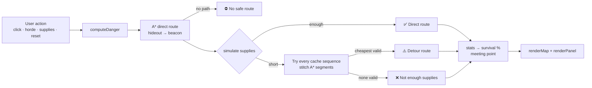

<div align="center">

# 📡 BEACON

**An offline survival route planner that runs from a single HTML file.**

Plans the safest path across a zombie-infested city with A* search, budgets food and water along the way, and re-plans instantly as the threat changes.


[Quick start](#-quick-start) · [How it works](#-how-it-works) · [Configuration](#%EF%B8%8F-configuration) · [Architecture](#-code-architecture) · [Contributing](#-contributing)

</div>

<!-- Tip: add a screenshot or GIF of the app here, e.g. docs/preview.png -->

---

## 📖 Overview

It is **Day 19** of a zombie outbreak. Two survivors, **Aarav** 🧑 and **Mira** 👩, need to get from their hideout 🏠 to a survivor beacon 📡 on the far side of the city. There is no internet and no maps app, only BEACON.

BEACON is a small decision-support tool written as a single-page app. It:

- finds the **safest** route, not just the shortest one, by penalising streets near zombies;
- checks whether the survivors' **food and water** will last the trip, and if they won't, plans a **detour through supply caches**;
- reports a **survival chance**, a plain-language **decision**, and **step-by-step directions** for each survivor, including a meeting point in case they get separated;
- **re-plans immediately** when you drop or clear a zombie, change supplies, or trigger a sudden horde.

Everything (markup, styles and logic) lives in [`index.html`](index.html). There is no build step, no package manager, no framework and no network request.

## ✨ Features

| Feature | What it does |
| --- | --- |
| 🧭 **Safest-route planning** | A* search over a 20 × 14 city grid, weighted by danger from nearby zombies |
| 🟥 **Danger zones** | Streets 1 step from a zombie are dark red, streets 2 steps away are light red, and both cost more to cross |
| 🍞💧 **Supply simulation** | Walks the route step by step, consuming food and water, and flags the exact step a resource runs out |
| 🔀 **Automatic supply detours** | When supplies fall short, tries every ordering of every set of caches and picks the cheapest route that works |
| 🚨 **Sudden horde** | Drops up to 4 zombies onto the middle of the current route, shows the old route as a ghost, and compares old vs new |
| 🚩 **Team plan** | Splits the route at its midpoint: Aarav leads the first leg, Mira the second, with a marked meeting point |
| 📴 **Fully offline** | Zero dependencies and zero network calls. Save the file and it works anywhere |
| ♿ **Accessible by default** | Semantic landmarks, ARIA live regions and alerts, keyboard focus styles, and `prefers-reduced-motion` support |
| 📱 **Responsive** | Two-column layout on desktop, single column below 920 px, tighter spacing below 600 px |

## 🚀 Quick start

### Option 1: open the file

```bash
git clone https://github.com/omezkhannote4-hash/beacon.git
cd beacon
open index.html          # macOS
# xdg-open index.html    # Linux
# start index.html       # Windows
```

That's all. No install step.

### Option 2: serve it locally

Some browsers restrict features on `file://` URLs. A static server avoids that:

```bash
python3 -m http.server 8000
# then visit http://localhost:8000
```

### Option 3: deploy to GitHub Pages

1. Go to **Settings → Pages** in this repository.
2. Under **Build and deployment**, choose **Deploy from a branch**, then pick `main` and `/ (root)`.
3. Save. The app will be published at `https://omezkhannote4-hash.github.io/beacon/`.

### Requirements

Any current evergreen browser (Chrome, Edge, Firefox, Safari). The app uses `Set`, `Map`, `Uint8Array`, CSS `aspect-ratio` and container query units (`cqi`). A `min()` font-size fallback covers browsers without container queries.

## 🎮 Usage

| Action | How |
| --- | --- |
| Drop a zombie | Click or tap any street cell |
| Clear a zombie | Click or tap a 🧟 |
| Trigger a horde | **🚨 Sudden horde** blocks the middle of the current route |
| Adjust supplies | Use the **−** / **+** steppers (range 0–20) |
| Start over | **↺ Reset city** restores the original map and supplies |

Buildings, the hideout, the beacon and supply caches can't be changed. Clicking them shows an explanatory toast.

### Reading the panel

- **Survival chance**: green at 70% or above, orange from 40% to 69%, red below 40%.
- **Decision**: one of four outcomes:
  - ✅ **Route OK**: supplies cover the direct route.
  - ⚠️ **Detour**: the direct route would run out of supplies, so the plan goes via one or more caches.
  - ❌ **Not enough supplies**: no combination of caches makes the trip possible. Ration or wait.
  - ⛔ **No safe route**: zombies have sealed every path. Clear a street.
- **Supplies**: what you'll have left on arrival, or the step where each resource runs out.
- **Next moves**: compressed directions (e.g. `➡️ 4 east, ⬇️ 3 south`) for each survivor's leg.

With the default map and supplies, BEACON plans a **32-step** route with **no red cells** and a **94%** survival chance. The survivors arrive with 1 food and 1 water.

## 🧠 How it works



### 1. Danger field

Each zombie projects danger over a Manhattan radius of 2:

| Distance from zombie | Danger level | Step cost | Shown as |
| --- | --- | --- | --- |
| 0 (zombie cell) | 3 | impassable | 🧟 |
| 1 | 2 | **8** | dark red |
| 2 | 1 | **4** | light red |
| ≥ 3 | 0 | **1** | street |

When zones overlap, a cell keeps the highest danger level that reaches it.

### 2. A* search

- 4-directional movement over the grid. Buildings and zombie cells are impassable.
- The heuristic is **Manhattan distance**. It is admissible because the cheapest step costs 1, so A* returns the minimum-cost (safest) path.
- Ties on `f = g + h` go to the node closer to the goal, which keeps routes direct.
- A guard of 20,000 iterations protects against runaway loops.

### 3. Supply simulation

Walking the route step by step, the simulation:

- uses **1 food every 8 steps** and **1 water every 6 steps**;
- adds **+3** for each cache on the path (each cache can be collected once);
- marks a resource as failed the first time it drops **below zero**, and records that step.

### 4. Detour search

If the direct route fails the supply check, BEACON tries **every ordered subset of the caches**. With the 4 default caches that is 64 sequences. For each sequence it stitches together A* segments (`hideout → cache₁ → … → beacon`), memoising each segment, then simulates supplies. The **lowest-cost** route that passes the simulation wins.

### 5. Survival score

```text
survival = clamp(5, 99, 100 − 6·darkRedSteps − 3·lightRedSteps − ⌊steps / 5⌋)
```

This heuristic rewards routes that avoid danger and stay short. It is **not** a probabilistic model.

### 6. Sudden horde

The horde places zombies on up to **4 route cells nearest the route's midpoint**, skipping the hideout, the beacon, caches and existing zombies. The previous route stays visible as a dashed ghost, and the panel shows an old-vs-new comparison of steps and survival chance.

## ⚙️ Configuration

All tunables are constants at the top of the `<script>` block in [`index.html`](index.html):

| Constant | Default | Meaning |
| --- | --- | --- |
| `START_FOOD` | `5` | Food at the start and after reset |
| `START_WATER` | `6` | Water at the start and after reset |
| `FOOD_EVERY` | `8` | Steps per unit of food consumed |
| `WATER_EVERY` | `6` | Steps per unit of water consumed |
| `CACHE_GAIN` | `3` | Units gained from each cache |
| `MAX_SUPPLY` | `20` | Upper limit on the supply steppers |

Step costs (`8` / `4` / `1`) are in `stepCost()`, and the survival weights are in `stats()`.

### Editing the city map

The map is an array of strings in `MAP`:

```text
H = hideout   B = beacon   # = building   . = street
Z = zombie    F = food cache   W = water cache
```

Rules when you edit it:

- Exactly **one** `H` and **one** `B`.
- Every row must be exactly `COLS` characters long, and there must be exactly `ROWS` rows.
- If you change the grid size, update `COLS` / `ROWS` **and** the CSS `grid-template-columns: repeat(20, 1fr)` on `.map`, as well as the map's `aria-label`.
- The detour search grows **factorially** with the number of caches (4 → 64 sequences, 6 → 1,956, 8 → 109,600). Keep the cache count small, or replace the brute-force search before adding many caches.

## 🏗️ Code architecture

The script is a single IIFE in strict mode, split into numbered sections:

| # | Section | Key functions | Responsibility |
| --- | --- | --- | --- |
| 1 | Fixed city | — | Parses `MAP` into walls, zombies, caches, start and goal. Precomputes cache sequences |
| 2 | Danger zones | `computeDanger`, `stepCost`, `passable` | Builds the danger field and movement costs |
| 3 | A* | `astar` | Safest path between two cells |
| 4 | Supplies | `simulate`, `stats` | Resource consumption and survival scoring |
| 5 | Full plan | `makePlan` | Combines route, detour search and meeting point into one plan object |
| 6 | Render | `renderMap`, `renderPanel`, `dirsText`, `legNote` | Turns the current state and plan into DOM |
| 7 | Effects | `toast`, `flash`, `showHordeBanner`, `safe` | Feedback and error containment |
| 8 | Actions | `onCell`, `horde`, `reset`, `changeSupply` | Event handlers that mutate state and call `update()` |

**Data flow is one-directional:** an action changes `state`, then `update()` rebuilds the plan from scratch, then the whole view is re-rendered. The grid has only 280 cells, so a full re-plan and re-render is instant. This keeps the code free of incremental-update bugs.

**Error handling:** every event handler is wrapped in `safe()`. An exception is logged to the console and shown to the user as a recoverable toast instead of breaking the page.

### Debugging hook

A harmless global is exposed for inspection in the browser console:

```js
BEACON.state            // live state: zombies, supplies, danger field, current plan
BEACON.state.plan       // { status, route, steps, surv, sim, seq, meet, ... }
BEACON.state.food = 2;  // mutate state...
BEACON.replan();        // ...then re-plan and re-render
```

## 🧪 Testing

There is no automated test suite yet. Before opening a PR, run this manual checklist:

- [ ] Default load shows a **32-step**, **94%** route that arrives with 1 food and 1 water
- [ ] Dropping a zombie on the route re-routes it, and red zones appear around the zombie
- [ ] From the defaults, lowering water to **4** (or food to **3**) triggers a ⚠️ **detour** through a cache
- [ ] Lowering water to **3** or below (or food to **1** or below) shows **NOT ENOUGH SUPPLIES**
- [ ] **🚨 Sudden horde** shows the banner, flash, ghost route and old-vs-new comparison
- [ ] Sealing every path shows **⛔ NO SAFE ROUTE**
- [ ] **↺ Reset city** restores the original map and supplies
- [ ] The layout works at phone width, and animations stop with *Reduce motion* enabled

Because the planning logic (sections 1–5) has no DOM dependencies, it can be moved into its own module and unit-tested in Node. That is the natural first step towards automated tests.

## 🗺️ Roadmap

- [ ] Extract planning logic into a testable module, with unit tests for `astar`, `simulate` and `makePlan`
- [ ] Replace the linear-scan open list with a binary heap for larger maps
- [ ] Replace the brute-force cache search with a smarter search to support more caches
- [ ] Load custom maps from a text or JSON file
- [ ] Moving zombies and time-step simulation
- [ ] Keyboard navigation of grid cells
- [ ] Optional PWA manifest and service worker, so the app can be installed to a home screen

## 🤝 Contributing

Contributions are welcome.

1. Fork the repo and create a branch: `git checkout -b feat/short-description`
2. Keep the project **dependency-free** and **single-file**. That constraint is the point of the project.
3. Match the existing style: ES5 syntax, `"use strict"`, small functions, and comments that explain *why*.
4. Run the [manual checklist](#-testing) in at least one Chromium-based browser and one other browser.
5. Open a pull request that describes the change, with a screenshot or GIF for UI changes.

Commit messages should follow [Conventional Commits](https://www.conventionalcommits.org/) (`feat:`, `fix:`, `docs:`, `refactor:`).

## 📄 License

No license has been chosen yet. Until one is added, all rights are reserved by the author. To allow reuse, add a `LICENSE` file; [choosealicense.com](https://choosealicense.com/) can help you pick one (MIT is a common choice for small projects like this).

---

<div align="center">
<sub>Built with plain HTML, CSS and JavaScript. No internet required. 📡</sub>
</div>
